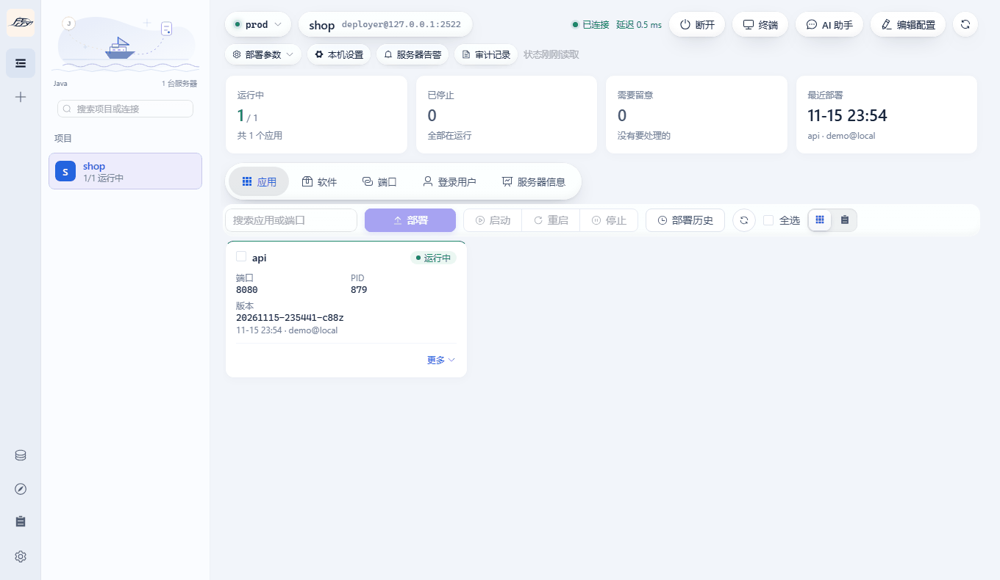

# Ferry

[简体中文](README.md)

Ferry deploys backend applications and static sites to Linux over SSH and runs services with systemd.

[Download Ferry](https://github.com/shelbeii/ferry/releases/latest) · [5-minute quickstart](docs/en/quickstart.md) · [Configuration reference](docs/en/config.md)

## What you can do

- Select applications in the desktop app or run `ferry deploy prod`. Ferry builds and verifies artifacts, uploads changes, waits for services to become healthy, and rolls back failed starts.
- Deploy Spring Boot JARs, native Linux executables, static sites, Python, Node.js backends, and .NET applications. Roll out in batches, start with a canary, or use two deployment slots for zero-downtime switching.
- Inspect logs, ports, resource usage, and audit records. Manage server alerts and backups, open an SSH terminal, or connect a coding client through MCP.

## Install

| Platform | Installation |
| --- | --- |
| Windows | Run `Ferry_<version>_x64-setup.exe`. Select the PATH option to use `ferry` in a terminal. |
| macOS | Download the `.dmg` for Apple silicon or Intel and drag Ferry into Applications. |
| Linux | Download `ferry-linux-amd64` or `ferry-linux-arm64`, make it executable, and place it on your PATH. |

Download the desktop app and CLI from [GitHub Releases](https://github.com/shelbeii/ferry/releases). The desktop interface and CLI messages are in Chinese. The English quickstart pairs each button's Chinese label with its English meaning.

If macOS cannot verify the developer, confirm that the installer came from Ferry's releases and follow [Apple's instructions for opening an app](https://support.apple.com/en-us/102445).

## Documentation

- [Quickstart](docs/en/quickstart.md) · [Configuration reference](docs/en/config.md)
- [CLI reference](docs/cli.md) · [CI deployment](docs/ci.md) · [Troubleshooting](docs/faq.md) (Chinese)
- [Deployment](docs/guides/deploy.md) · [Server operations](docs/guides/servers.md) · [Security](docs/guides/security.md) (Chinese)
- [Development and testing](docs/development.md) (Chinese)

[Apache License 2.0](LICENSE)
