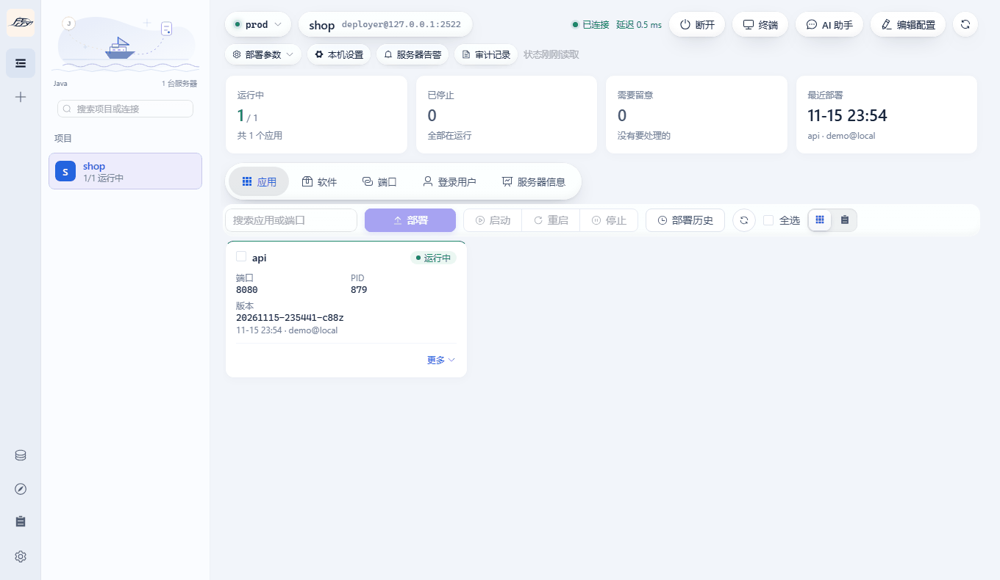

# Ferry

[English](README.en.md)

Ferry 通过 SSH 把后端程序和前端静态站点部署到 Linux，用 systemd 运行和管理服务。

[下载桌面版或 CLI](https://github.com/shelbeii/ferry/releases/latest) · [5 分钟上手](docs/quickstart.md) · [常见问题](docs/faq.md)

## 能做什么

- 在桌面版选择应用，或运行 `ferry deploy prod`。Ferry 会构建、检查产物、增量上传、等待服务就绪，并在启动失败时回滚。
- 部署 Spring Boot JAR、Go 等 Linux 原生程序、静态站点、Python、Node.js 服务端和 .NET 应用。可按批次发布、先发少量服务器验证，或用双槽位切换避免停机。
- 查看日志、端口、服务器资源和审计记录，配置告警与数据备份。桌面版也提供 SSH 终端、文件管理、数据库客户端和 AI 助手。

## 安装

| 平台 | 下载后怎么用 |
| --- | --- |
| Windows | 运行 `Ferry_<版本>_x64-setup.exe`。需要在终端用 `ferry` 时，安装时选加入 PATH。 |
| macOS | 下载匹配 Apple 芯片或 Intel 的 `.dmg`，将 Ferry 拖入「应用程序」。 |
| Linux | 下载匹配架构的 `ferry-linux-amd64` 或 `ferry-linux-arm64`，赋予执行权限后放入 PATH。 |

安装包和 CLI 在 [GitHub Releases](https://github.com/shelbeii/ferry/releases) 下载。从源码构建见[开发与测试](docs/development.md)。

如果 macOS 提示无法验证开发者，确认安装包来自 Ferry 的 Releases 后，参照[Apple 的打开应用说明](https://support.apple.com/zh-cn/102445)。

## 文档

| 要做什么 | 文档 |
| --- | --- |
| 第一次部署 Spring Boot | [5 分钟上手](docs/quickstart.md) |
| 按报错排查 | [常见问题](docs/faq.md) |
| 写 `ferry.yaml`、查询命令 | [配置参考](docs/config.md) · [命令参考](docs/cli.md) · [示例项目](examples/shop/) |
| 构建、发布、查看日志、回滚 | [部署与回滚](docs/guides/deploy.md) · [在 CI 部署](docs/ci.md) |
| 管理服务器、告警和备份 | [服务器运维](docs/guides/servers.md) · [软件配置](docs/software-config.md) · [告警与备份](docs/guides/monitor-backup.md) |
| 团队协作、管理凭据 | [团队协作](docs/guides/team.md) · [安全与本机数据](docs/guides/security.md) |
| 使用 AI 助手或接入编程软件 | [AI 助手与 MCP](docs/guides/ai-mcp.md) |
| 开发、调试和发布 | [开发与测试](docs/development.md) · [桌面版](desktop/README.md) · [发布说明](docs/releases/README.md) |

[Apache License 2.0](LICENSE)
