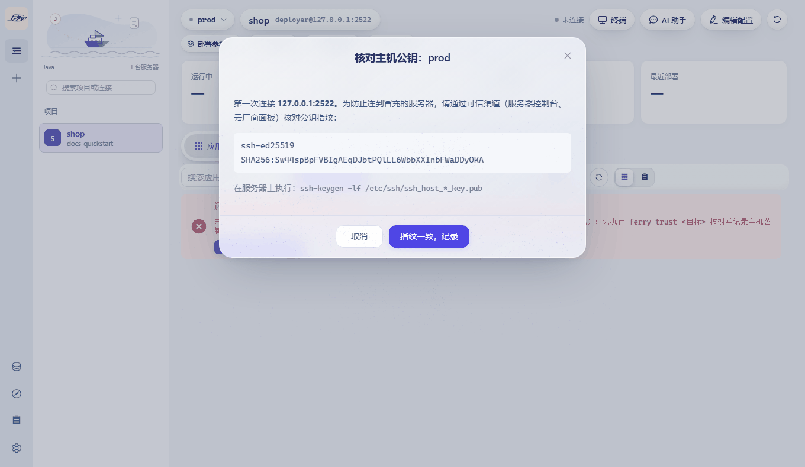
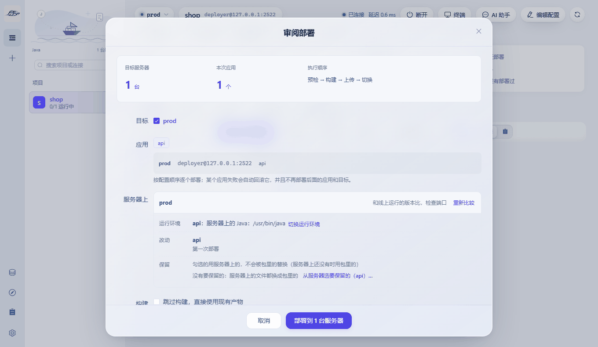
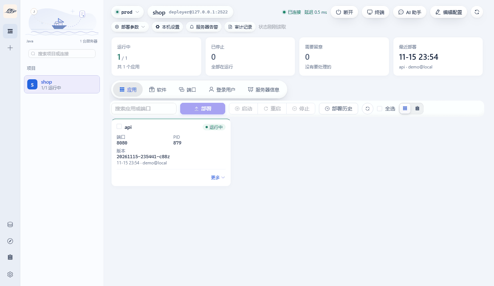

# 5-minute quickstart with Spring Boot

[简体中文](../quickstart.md) · [Install Ferry](../../README.en.md#install)

Deploy the [shop example](../../examples/quickstart/) to one Linux server and check that its `/health` endpoint responds. The first build may take longer while Maven downloads dependencies.

Install Ferry and JDK 21 or later on your computer, and confirm that `mvn -v` works. Use a Linux server with systemd, SSH, and Java 21 or later at `/usr/bin/java`. The example uses an SSH account called `deployer` with passwordless sudo and runs the app as `shop`. Sign in with your SSH key first and verify that `sudo -n true` succeeds.

If the server needs Java, replace `java: /usr/bin/java` with `runtime: {java: 21}` to have Ferry provision the JDK on the first deployment. [Service configuration](config.md#services)

## 1. Add the project

Copy [examples/quickstart](../../examples/quickstart/) to a writable folder. If you only have the installer, use **Code → Download ZIP** on the GitHub repository to get the example. Open [ferry.yaml](../../examples/quickstart/ferry.yaml) and set `targets.prod.host` and `user` to your server address and SSH user. Adjust `port` and `identityFile` if needed. If you sign in as root, set `user: root`, remove `sudo: true`, and keep `runAs: shop`.

In Ferry, click **添加已有项目 (Add existing project)** and select the YAML file. If Ferry already has projects, open the **+** menu on the left.


## 2. Verify the SSH host key

Click **核对并记录主机公钥 (Verify and save host key)**. From the server console, run `ssh-keygen -lf /etc/ssh/ssh_host_ed25519_key.pub` and compare its fingerprint with the one in Ferry. If the dialog shows a different key type, use the corresponding `ssh_host_*_key.pub` file. When the fingerprints match, click **指纹一致，记录 (Save matching fingerprint)**.



## 3. Deploy api

Select `api` and click **部署 (Deploy)**. In **审阅部署 (Review deployment)**, confirm `prod` and `api`, then click **部署到 1 台服务器 (Deploy to 1 server)**. Ferry runs `mvn -q clean package` locally, uploads `target/shop.jar`, starts the systemd service, and checks `/health`.



## 4. Check the service

Wait for **完成 (Complete)** in the task drawer and check that the result for `api` is `OK`. Close the drawer and check that `api` shows **运行中 (Running)**. Run this command from an SSH session on the server. It should return `OK`.

```sh
curl -fsS http://127.0.0.1:8080/health
```



## Deploy from the CLI

In the directory containing the example's `ferry.yaml`, run these commands. Verify the host fingerprint when `ferry trust` prompts, as described above.

```sh
ferry validate
ferry trust prod
ferry preflight prod api
ferry deploy prod api
ferry status prod api
```

To deploy an existing executable Spring Boot JAR, set `artifact.path` to that file, point the health check at your app, and run `ferry deploy prod api --skip-build`. [Configuration reference](config.md) · [Troubleshooting with original error messages (Chinese)](../faq.md)
