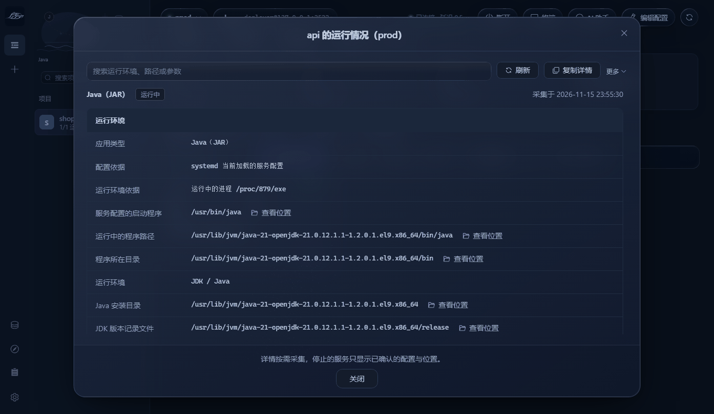

# 部署与回滚

## 配置示例

一个后端 + 一个前端的最小配置。完整字段见 [docs/config.md](../config.md)，多服务项目的例子见 [examples/shop](../../examples/shop/)（11 个 Spring Boot 服务、两台服务器）。

```yaml
version: 1
project: myapp

vars:
  profile: prod

builds:
  maven:
    command: mvn -pl ${each:module} -am clean package -DskipTests   # 多个应用共用时只执行一次

targets:
  prod:
    host: 10.0.0.10
    user: root
    identityFile: ~/.ssh/id_ed25519
    root: /opt/myapp          # 部署根目录：必须归 root，其他用户不可写
    runAs: myapp              # 服务的运行用户（不能是 root；服务器上没有时部署会自动创建）

apps:
  - name: api
    type: java                # java | binary | static
    order: 10
    build: maven
    vars: {module: api}
    artifact:
      path: api/target/api.jar
      verify:
        springBoot: {}        # 检查是 Spring Boot 可执行 JAR
    service:
      runtime: {java: 21}     # 由 Ferry 提供 JDK；也可以用 java: /usr/bin/java 指定服务器上的
      jvmArgs: [-Xmx512m, "-Dlogging.file.path=${logs}"]
      args: ["--spring.profiles.active=${profile}"]
      envFile: -/etc/myapp/api.env      # 密码等放这里，不要写进 ferry.yaml
      health: {tcp: "8080"}

  - name: web
    type: static
    order: 20
    build: {command: npm run build, workdir: web}
    artifact: {path: web/dist}
    static:
      nginxInstance: edge     # 先在软件中安装名为 edge 的 nginx 实例
      port: 80
      proxy:
        /api/: http://127.0.0.1:8080/
```

## 一次部署的过程

`ferry deploy prod` 依次做这些事：

1. **连接与预检**：核对主机公钥，上传或复用 agent；检查系统、架构、systemd、运行用户、剩余空间、部署目录的安全性，以及运行用户能不能访问单元里用到的程序和目录（访问不了的默认自动修正）。多个目标时先把所有目标都预检完、确认一次再开始。
2. **构建**：执行构建命令。同名构建跨进程串行；多个应用共用一条构建时只执行一次。
3. **检查产物**：Spring Boot 可执行 JAR、必须包含的依赖、原生程序的 CPU 架构、静态目录的 `index.html`。产物不能早于这次构建开始的时间，防止用到旧包。Java 应用还会比对 jar 需要的 Java 版本和服务器上的 java。
4. **上传**：fat jar 只传服务器上没有的部分（依赖按 sha256 缓存），大文件多连接并行；最后用整个文件的 sha256 核对。
5. **逐个切换**：按 `order` 逐个应用：停止 → 切换版本 → 启动 → 等待就绪（进程存活、健康检查通过、稳定运行一段时间）。
6. **失败处理**：某个应用失败时显示原因（日志末尾或 journald，去掉了堆栈），回滚这个应用，后面的应用和目标都不再部署。
7. **记录**：提交号、分支、是否有未提交修改、sha256、部署人、时间，服务器和本机各记一份。

多台服务器可先发布一台并观察，再继续发布其余服务器。下面的命令配置了 2 分钟观察期、每批最多 2 台，任一台失败时回滚本次已切换的服务器。[多台部署配置](../config.md#部署到多台rollout)

```sh
ferry deploy prod-a,prod-b,prod-c --canary 1 --observe 2m --batch 2 --on-failure rollback
```

## 版本切换与回滚

- **原子切换**：运行中的版本在 `running/`，其他版本在 `versions/<版本>/`，切换只是改名。保留最近 N 个版本（`keepReleases`，当前版本和上一个可用版本始终保留）。
- **附带文件**：程序要读的配置文件、证书、启动脚本（`artifact.files`）和程序放在同一个目录，每次部署一起上传，回滚时一起回滚；可以按服务器用不同的文件。新建项目时可以直接添加，识别项目时会列出看着像配置的文件。
- **保留服务器上的文件**：服务器上改过的配置文件、上传目录这类不想被包里的替换的（`artifact.keep`），部署时从运行中的版本带进新版本；服务器上还没有时用包里的。写 `shared: true` 的放在应用的 `data/` 下只有一份，每个版本链接过去，回滚时不动（上传目录等）；不写的跟着版本走，回滚时回到那个版本的样子。部署窗口里可以这次不保留某一项、从服务器上的文件里勾选要保留的，选「记到 ferry.yaml」以后都这样；服务器上的和包里的不同时会提醒（包里改的这次不会上线）。

  ```yaml
  artifact:
    path: dist
    keep: [config.js, "conf/*.json", {path: uploads, shared: true}]
  ```
- **不停机发布**（`service.zeroDowntime`）：两个端口轮流用，新版本在空着的端口启动、就绪后再停旧的，失败时旧版本一直没停过；直接对外的应用由 Ferry 的 nginx 在前面转发。经注册中心（Nacos）互相调用的服务、网关都适用。
- **后端 HTTPS**：应用配置 `https.domains` 后，可通过 nginx 自动申请、续期证书，也可使用自带证书。不停机发布时，HTTPS 会转发到当前槽位。见 [后端 HTTPS 配置](../config.md#后端-httpshttps)。
- **部署时执行的命令**（`hooks`）：切换前（如数据库迁移，失败就不切换）、就绪后（如预热、刷新缓存，失败就回滚）在服务器上执行自己的命令，以运行用户的身份，和服务拿到一样的环境变量。
- **部署前后对比**：确认前列出每个应用线上运行的版本、这次要上线的提交（`ferry changes <目标>` 也能单独看）；线上有本地没有的提交（别的分支、别人刚部署了更新的）时提醒，部署会把它们去掉。部署后说新版本从启动到就绪用了多久，比上次慢很多时提醒。
- **Python、Node 服务端、.NET**（`type: python | node | dotnet`）：上传整个目录（`.venv`、`node_modules`、`.git` 等不传），由 `service.exec` 启动。Python 的依赖在服务器上装进 venv（`requirements.txt`），Node 的依赖在服务器上 `npm ci`；装好的依赖按依赖文件的哈希存着，依赖没变的部署直接复用，回滚时各版本用各自的依赖；可以填 pip / npm 的镜像源。.NET 推荐自带运行时发布，服务器上不用装 .NET。新建项目时自动认出 FastAPI、Flask、Django、NestJS、Next.js、Express、ASP.NET Core。见 [docs/config.md](../config.md)。
- **崩溃立即判失败**：等待就绪时进程一旦退出（`failed`、`auto-restart`、主进程号变了）马上判失败，不用等满超时。兼容 systemd 219。
- **回滚**：默认回到当前版本之前最近一个没失败的版本，也可以 `--to <版本>` 指定；回滚后启动失败会切回原版本。
- **接管已有的服务**：单元文件已存在、但不是 Ferry 生成的，第一次部署会接管它，原文件保存下来。接管失败自动恢复；之后也能 `rollback --to legacy` 回到接管前。
- **端口冲突**：`conflicts` 里的同端口单元部署前停止，成功后取消开机自启，失败回滚时恢复。
- **互斥**：同一台服务器上的部署、回滚、启停用 flock 互斥，拿着锁的会记下是谁、在做什么：别人这时看到「张三正在部署 api」，再部署会等对方做完；本机的同名构建锁跨进程串行，避免两个部署同时打包、互相覆盖产物。
- **构建前检查占用**：Windows 上如果有进程正占着要构建的 jar，部署前会指出来，可以结束它（`ferry busy`）。

## 上传

- **增量上传**：Spring Boot fat jar 拆成「依赖 jar」和「其余字节」，每次上传从服务器现有版本提取可复用依赖，一般只要上传业务代码（商城项目的 System：上传 2.0 MB，jar 共 151.8 MB）。拼回的文件和本地逐字节一致。依赖按上传任务隔离，成功、失败或取消后删除，不长期保留展开的副本；并行上传互不影响。缓存损坏时自动删掉坏文件、改成全量重传，在这之前不动任何服务。
- **多连接切片**：一次上传超过 8 MB 时切成 4 MB 的片，多条 SSH 连接同时写（默认 6 路，每个目标可单独设置 `uploadStreams`），应对 VPN 等对单条连接的限速。

## 运行环境（JDK、nginx）



- **JDK**：`service.runtime: {java: 17}` 让 Ferry 提供 JDK。本机没有时先下载（默认 Adoptium，可换镜像或手动导入），上传到服务器的 `<ferryDir>/runtimes/`，同一台服务器上的项目共用。服务器上的 java 不够新时，桌面版可以一键改用 Ferry 提供的 JDK。
- **HTTPS 证书**：`static.https` 写上域名，服务器上的 Ferry 自动向 Let's Encrypt 申请证书、每天检查续期，http 自动跳到 https。默认 HTTP 验证；80 端口外网访问不了或要通配符证书时，用阿里云、腾讯云 DNSPod、Cloudflare 的 DNS 验证。
- **nginx**：添加前端项目时可选择已有系统 nginx（`system:nginx.service`），或在「连接 → 软件」安装的独立实例，再配置端口、域名和接口代理（`static.nginxInstance`）。多个项目共用一个实例，站点配置经校验后重新加载，项目启停只影响自己的站点。旧配置只写 `static.port` 时继续沿用独立 nginx 运行环境；也可以只放文件，手动接入已有 nginx（`static.link`）。见 [软件配置与前端 nginx](../software-config.md)。

## 日志

- 当前运行的 journald 输出只显示「从这次运行开始」的部分；也可以看程序自己写的日志文件（`diagLogs` 或 `logs/` 下的任意文件，支持通配符）。
- 按天切分的日志、`.gz` 压缩的日志都能直接看；持续输出时到了第二天自动换到新文件。
- 关键字搜索（服务输出、某个日志文件或这次运行的全部日志文件），跳到某一行附近。
- 日志和程序放在一起：每个版本有自己的 `logs/`。每次切换版本时，离开的版本连同日志一起归档，以往每次运行的日志都能查（`ferry logs … --runs`），随版本清理。

## 服务器上的目录

```text
<root>/                            部署根目录（如 /opt/myapp），root 所有
├── .ferry/
│   ├── lock  lock.who             部署 / 回滚 / 启停互斥；lock.who 是正在做的人和操作
│   ├── backup/                    数据备份的设置、各项最近的结果
│   ├── history.jsonl              部署历史
│   ├── cache/<id>/lib/<sha256>.jar 本次增量上传的依赖（结束即删）
│   ├── incoming/<id>/             每次部署的上传目录（结束即删，残留 12 小时后清理）
│   └── apps/<应用>/                各应用里 Ferry 自己的文件（不放在应用目录里）
│       ├── running                running/ 里是哪个版本
│       ├── run.json  legacy/      当前运行的开始时间、接管前的单元文件
│       ├── nginx.conf             Ferry 的 nginx 在用的配置（静态站点）
│       └── versions/<id>/         release.json（提交、sha256、部署人）、unit.service、各次运行的记录、
│                                  runs/<时间>/logs/（这个版本更早的运行：回滚回来再次运行时，上一次的日志移到这里）
├── runtimes/                      Ferry 自带的 nginx（静态站点用）
└── apps/<应用>/
    ├── running/                   运行中的版本，也是服务的工作目录：程序、附带文件（artifact.files，静态站点在 www/）和它运行时写的日志 logs/
    ├── versions/<id>/             其他版本：程序、附带文件和它上一次运行时的日志 logs/（切换时就是 running/ 改名放回来）
    ├── data/                      不随版本变化的目录（sharedDirs、artifact.keep 里共用的），归运行用户；配置里用到时才有
    └── deps/<种类>-<哈希>/         python 的 venv、node 的 node_modules（版本目录里的 .venv、node_modules 链接到这里）
<root>/backups/<名字>/             数据备份的文件（只有 root 能读）
<应用的 root>/apps/<应用>/          应用单独设置了 root 时在这里（Ferry 的文件仍在目标 root 的 .ferry/apps/<应用>）
<ferryDir>/ferry-agent-<sha>             agent（保留最近 3 个；ferryDir 默认 /usr/local/lib/ferry）
<ferryDir>/runtimes/jdk-<版本>-<架构>/    Ferry 提供的 JDK；java-<N> → 当前使用的
<ferryDir>/ferry-monitor、monitor/        服务器告警（ferry-monitor.timer）
<ferryDir>/ferry-backup                   数据备份的定时器（ferry-backup-*.timer）运行它
/etc/systemd/system/<单元>.service       Ferry 生成（第一行 # managed by ferry）
```

以前的目录结构（`releases/`、`shared/`、`legacy/`、`.run.json`，0.12.16 的 `current` 链接，0.12.17 应用目录里的 `.ferry/`）在下一次部署或回滚时自动换成上面的结构，以前写在 `data`（`shared`）下的日志并进它那个版本的 `logs/`；换之前照常能看。以前版本保存的单元文件、nginx 配置里的 `current` `shared` 路径，回滚时自动换成 `running` `data`。
