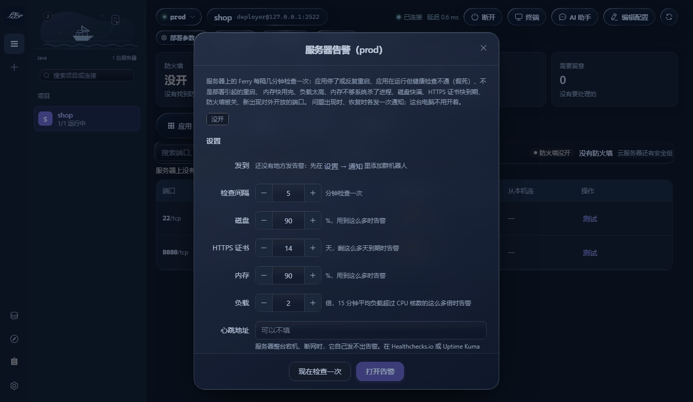

# 告警与数据备份

## 服务器告警

- 在桌面版的「服务器告警」里打开（或 `ferry monitor <目标> on`）：服务器上的 Ferry 每隔几分钟检查一次，这台电脑不用开着。
- 检查应用停了 / 启动失败在反复重启、应用在运行但健康检查不通（`service.health` 平时也探，假死也能发现）、不是部署引起的重启、内存快用完（附上占得最多的进程）、负载太高、内存不够系统杀了进程（OOM）、磁盘快满、HTTPS 证书快到期、防火墙被关、新出现对外开放的端口、数据备份失败或没传到异地。问题出现时、恢复时各发一次（发到「设置 → 通知」里的群），不会每次检查都发。
- **心跳**：服务器整台宕机、断网时它自己发不出告警。在 [Healthchecks.io](https://healthchecks.io) 或 Uptime Kuma（Push 类型）建一个检查，把地址填进「心跳地址」（`--ping URL`）：每次检查完访问一下，那边超过间隔没收到就由那边告警。
- 可以发测试告警、现在检查一次；随时关闭。

## 数据备份

- 配置里写 `backups`（MySQL、PostgreSQL、目录、自己写的命令），在桌面版的「数据备份」里打开后服务器上按时备份（每项一个 systemd 定时器），也可以部署前先备份一次（`beforeDeploy`，失败就不部署）。随时可以关，关掉后已有的备份留着。
- 数据库在 Docker 容器里（1Panel 装的）也能备份；密码放在服务器上的 `envFile` 里，不写进配置。
- 一键恢复：恢复前自动先备份一份现在的，恢复错了还能回去；可以把备份下载到这台电脑。保留最近 N 份。定时备份失败时，开着服务器告警就会发告警。
- **传到异地**（`upload`）：每次定时、手动备份完，再加密（age 格式）传一份到阿里云 OSS、腾讯云 COS、MinIO 等 S3 兼容的对象存储，那边也只留最近 N 份；服务器整台没了时，在新服务器上「取回」再恢复。
- `ferry backup <目标> [on | off | run | list | restore | download …]`，见 [docs/config.md](../config.md)。
