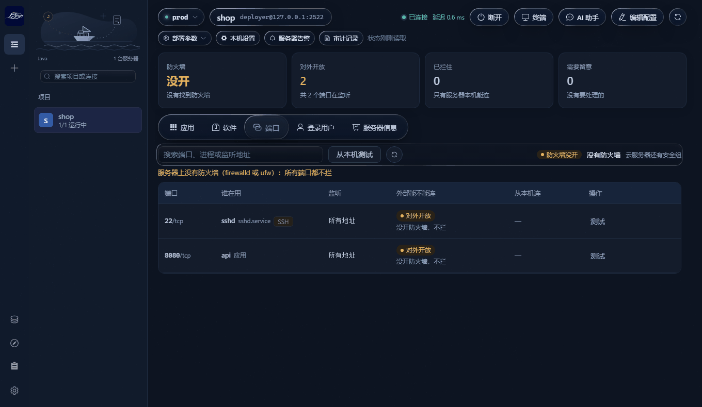

# 服务器运维

## 服务器上的软件

- **查看**：服务器上已有的数据库、缓存、注册中心等（MySQL、Redis、Nacos、Sentinel……），包括 Docker 和 1Panel 装的，显示版本、端口、运行状态。不是 Ferry 装的软件，只要是 systemd 服务或 Docker 容器，也能启停、看日志。
- **安装**：按软件模板安装。内置 Nginx、Nacos、Sentinel、MySQL、Redis、MariaDB、PostgreSQL、MinIO、ZLMediaKit 的模板，也可以自己写模板（桌面版有模板编辑器）。包安装使用本机安装包库；系统软件源安装可通过本机网络代理获取。
- **配置**：软件卡片与列表中的「配置」可查找、关联、查看和编辑文本配置。保存前检查远程变更并自动备份，支持恢复；nginx 校验后重新加载，其他系统服务和容器按需重启。项目生成的配置引导修改 `ferry.yaml`。见 [配置管理说明](../software-config.md)。

## 端口与防火墙

- 服务器页的「端口」：每个端口是哪个程序（应用、软件、容器）在用、监听哪些地址，防火墙放没放行、是哪条规则，外部到底能不能连。
- 防火墙是 firewalld 或 ufw 时可以直接放行、关闭端口（运行时和永久配置一起改，服务器日志里记一条）。SSH 端口不能关；只在这次开机有效的放行标成「临时」。
- 防火墙装了没开（firewalld 或 ufw）时可以「打开防火墙」：先放行 SSH 端口和你勾的端口（默认勾上现在对外开放的、不宜对外的不勾，UDP 端口自己填），再打开；Docker 在运行时同时重启 Docker。打开后 Ferry 马上用新的连接试 SSH，连不上的话 3 分钟后服务器自动关掉防火墙、恢复原样。没装防火墙的不替你装。
- 防火墙（firewalld 或 ufw）在运行时可以「关闭防火墙」：确认框里列出关掉后外部会连得上的端口；开机也不再启动，放行规则留在配置里，再打开时照旧；Docker 在运行、关的是 firewalld 时同时重启 Docker。Ferry 在 `DOCKER-USER` 里拦 Docker 端口的规则不受影响。
- 只在服务器内部的虚拟网卡（libvirt 的 virbr0、Docker 网桥等）上监听的端口标成「只在内部网卡」，不算对外开放。
- 只显示、不改的情况：用 iptables / nftables 原始规则、端口范围或只对部分来源放行的规则。
- Docker 映射的端口不经过防火墙：「关闭」时在 Docker 的 `DOCKER-USER` 规则链里拦住从外网卡进来的连接，服务器本机、其他容器照常能连，不用重建容器；规则由 `ferry-docker-guard` 服务在开机、Docker 重启后自动加回。「改映射」说明怎么改成只映射到 127.0.0.1：1Panel 装的在 1Panel 里关「端口外部访问」，compose 的指出文件和服务、给出重建命令，docker run 的给出参数写法（Ferry 不替你重建）。
- 「从本机测试」从这台电脑连服务器的端口：服务器上放行了还连不上，多半是云服务商的安全组没放行。
- 「应用」里标红的「对外开放」端口点一下就到这里；装软件时选了允许其他机器连接，装完可以直接过来放行。

## 登录用户（SSH 连接）

- 服务器页的「登录用户」、「新建连接」的「登录用户」按钮：服务器上连着的每个 SSH 连接是谁（登录用户）、从哪个 IP 连的、什么时候连上、终端多久没输入、在干什么（终端里在跑的命令、传文件、执行命令），还有多少个连接正在登录（还没通过验证，多了多半是有人在试密码）。
- 可以断开连接（勾选后一起断开），里面正在运行的命令会被结束。本机 Ferry 正在用的连接（终端、文件、查看都经它）不能在这里断开。
- 登录用户不是 root、也不能免密 sudo 时：只能断开自己用户的连接，别的用户的连接可能看不到来源 IP。

## 服务器信息与资源使用

- 服务器页「登录用户」后的「服务器信息」，以及「新建连接」的「服务器信息」按钮：查看系统与内核、CPU 型号与架构、逻辑 CPU 数、运行时间、虚拟化环境、服务器时间和网卡地址。
- CPU 使用率按约一秒内的变化采样，平均负载列出 1 / 5 / 15 分钟的值；内存按「总量 − 可用」计算实际占用，同时显示缓存和 Swap。
- 各挂载点分别列出设备、文件系统、总容量、已用、可用、容量使用率和 inode 使用率。默认隐藏临时文件系统，可以勾选查看；不会把同一设备的多处挂载加总。
- 只读采集，不需要安装监控软件。「刷新」立即采样；页面打开、连接保持时按设置里的状态读取间隔自动刷新，断开后不自动重连。命令行用 `ferry server-info <目标>`，支持 `--json`。

## 终端、文件与连接

- 桌面版里可以打开服务器的交互式终端，浏览服务器上的文件、新建目录、改名、删除、上传、下载（SFTP，以登录用户的身份）。
- 「新建连接」可以只连服务器、不建项目，用来看软件、开终端、管理文件。

## 数据库

桌面版的「数据库」支持 MySQL、MariaDB 和 PostgreSQL，可以查看表、修改数据、执行查询、建表改表和导出。Redis 使用 SCAN 按组浏览键，可以编辑字符串、哈希、列表、集合、有序集合和流，也提供命令行。连接经服务器的 SSH 转发，数据库端口可以继续只对服务器本机或内网开放。
