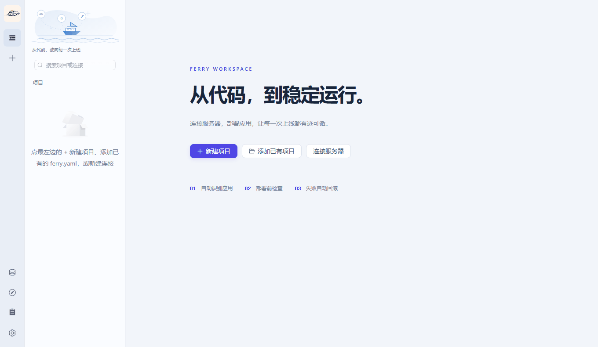
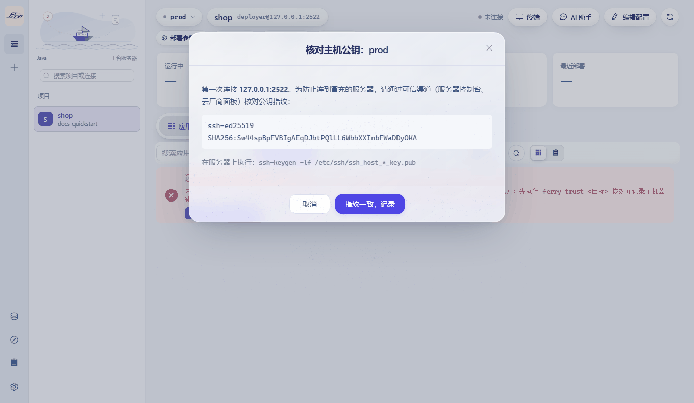
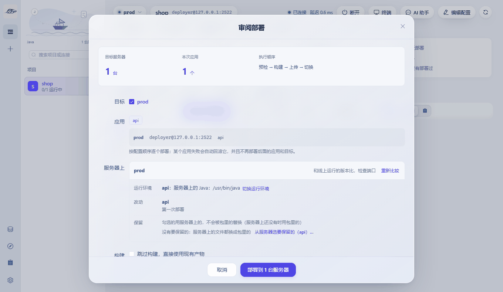
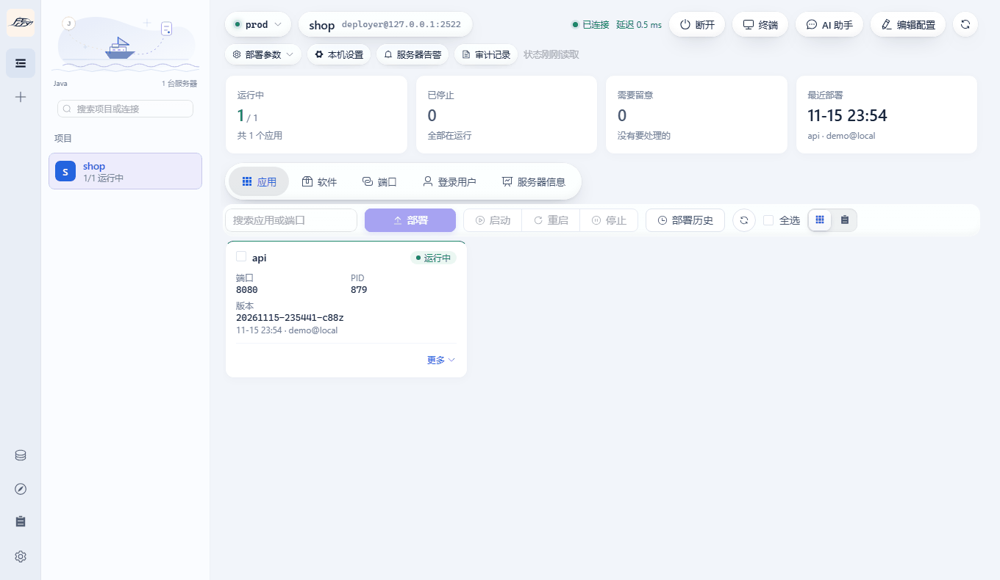

# 5 分钟上手：部署 Spring Boot

[English](en/quickstart.md) · [安装 Ferry](../README.md#安装)

用 [shop 示例](../examples/quickstart/) 在一台 Linux 服务器上部署 Spring Boot，在服务器内访问 `/health` 验证结果。首次下载 Maven 依赖的时间取决于网络。

开始前，在本机装好 Ferry 和 JDK 21 或更高版本，确认终端能运行 `mvn -v`。准备一台运行 systemd、有 SSH、在 `/usr/bin/java` 安装了 Java 21 或更高版本的 Linux 服务器。示例用可免密 sudo 的 `deployer` 登录，应用使用 `shop` 用户运行。请先从本机用自己的 SSH 私钥登录一次，并确认能执行 `sudo -n true`。

服务器还没有合适的 Java 时，将示例中的 `java: /usr/bin/java` 换成 `runtime: {java: 21}`，由 Ferry 在首次部署时准备 JDK。[JDK 配置](config.md#ferry-提供的运行环境jdk)

## 1. 添加项目

复制 [examples/quickstart](../examples/quickstart/) 到本机可写的目录。只有 Ferry 安装包时，可从 GitHub 仓库的「Code → Download ZIP」获取示例。编辑示例中的 [ferry.yaml](../examples/quickstart/ferry.yaml)，把 `targets.prod.host` 和 `user` 换成实际的服务器地址和 SSH 用户。按需修改 `port` 和 `identityFile`。如果以 root 登录，设置 `user: root` 并去掉 `sudo: true`，保留 `runAs: shop`。

打开 Ferry，点「添加已有项目」，选择刚改好的 `ferry.yaml`。已有其他项目时，从左侧的「+」菜单添加。



## 2. 核对服务器指纹

点「核对并记录主机公钥」。从服务器控制台运行 `ssh-keygen -lf /etc/ssh/ssh_host_ed25519_key.pub`，把结果与 Ferry 显示的指纹比较。Ferry 显示其他公钥类型时，用对应的 `ssh_host_*_key.pub`。一致后点「指纹一致，记录」。



## 3. 部署 api

勾选 `api`，点「部署」。在「审阅部署」中核对目标 `prod` 和应用 `api`，点「部署到 1 台服务器」。Ferry 在本机执行 `mvn -q clean package`，上传 `target/shop.jar`，由 systemd 启动服务并检查 `/health`。



## 4. 确认服务运行

等待任务中心显示「完成」，结果表里 `api` 显示 `OK`。关闭任务面板后，项目页的 `api` 显示「运行中」。用 SSH 登录服务器，执行下面的命令，应返回 `OK`。首次部署只需从服务器内确认健康检查。

```sh
curl -fsS http://127.0.0.1:8080/health
```



## 用 CLI 完成同样的部署

在示例的 `ferry.yaml` 所在目录运行以下命令。执行 `ferry trust` 时按第 2 步核对指纹。

```sh
ferry validate
ferry trust prod
ferry preflight prod api
ferry deploy prod api
ferry status prod api
```

如果已有 Spring Boot 可执行 JAR，可以把 `artifact.path` 改为该文件的路径，将健康检查改成应用实际的地址，再用 `ferry deploy prod api --skip-build`。遇到问题时按提示原文查找。[常见问题](faq.md) · [配置参考](config.md)
